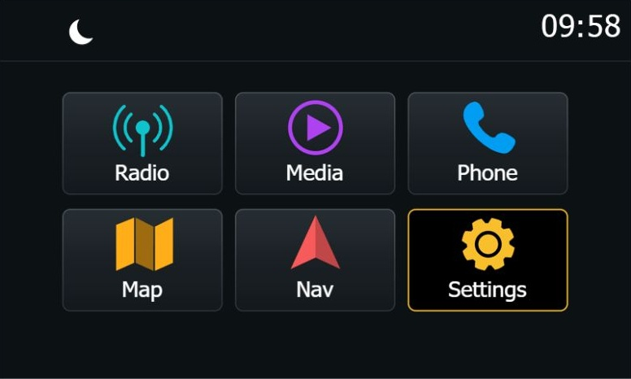
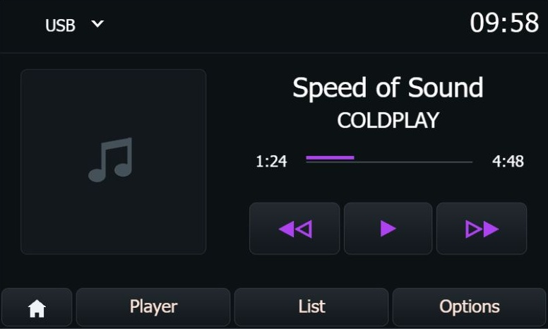

# MediaNav MAXmade — 7.0.6.MAX33

Upgrade the **first-generation Renault / Dacia MediaNav** from 4.x to Evolution software, with the MAXmade improvements included in **one USB update**.

| Home | Media |
| --- | --- |
|  |  |

Full before/after comparisons are in the [MAX04 design notes](releases/7.0.6.MAX04/README.md).

[Download upgrade.lgu](https://github.com/m-a-x-s-e-e-l-i-g/MediaNav-to-Evolution-Upgrade/releases/download/7.0.6.MAX33/upgrade.lgu) · [Release notes and checksum](releases/7.0.6.MAX33/README.md) · [Developer guide](docs/development.md)

**MAX33 adds resumable application installation and a Repair / resume update
action, alongside separate Windows CE access.**

**Hardware validation is unconfirmed.** The owner authorized MAX33 as the main
release on 22 October 2026 before physical testing. Its 185 offline checks and
full package verification passed; this does not confirm installation/recovery
on a real unit or guarantee recovery from every failure. See [MAX33 scope and
limits](releases/7.0.6.MAX33/README.md#scope-and-limits).

It retains MAX32's iPhone artwork fix from [emstoica](https://github.com/emstoica),
who reported Spotify/Apple Music covers working with the shipped Blue.exe.
Maintainer iPhone testing and intermittent missing covers after skips remain open.

## Why upgrade from 4.1.0 to 7.0.6.MAX33?

Compared with 4.1.0, the original upgrade to Evolution software brought these improvements on Max's unit:

- **Smoother Bluetooth music:** less stuttering, quicker phone connection and less waiting when changing songs.
- **Better touch response:** the screen reacts more quickly to taps.
- **Remembered volume:** the unit keeps your volume level when you turn off the car.
- **The Evolution interface:** newer software on your existing MediaNav.

MAXmade builds on that upgrade and adds:

- **DBoot 2.0 access included:** open the underlying Windows CE desktop to browse and copy files, make backups and use CE tools. This major benefit of the original conversion is retained in MAXmade. See [how to open Windows CE with DBoot](#access-windows-ce-with-dboot).
- **Less Bluetooth audio delay:** reduces the lag between playback on your phone and sound from the speakers.
- **Eight saved phones instead of five:** remember more phones without deleting an old one first. The list has two pages; you still connect one phone at a time.
- **The navigation fix included:** the fix for the **“File corruption detected”** error is part of this update. You do not need to install a second update for it.
- **Bluetooth album art sync:** supported phone covers display in the large USB-style player, alongside title and artist information. Includes MAX32's final-packet fix; contributor-reported Spotify/Apple Music success and pending maintainer testing are recorded separately.
- **Saved USB debugging:** enable Debugging in System Settings to collect separate USB log sessions across restarts, with navigation action/RAM measurements and fewer repetitive records.
- **Navigation without the recurring warning:** open Navigation or Map directly, without having to press Agree every time.
- **Redesigned UI throughout:** Navigation, Home, Settings, Radio, Media, Phone and the volume popup share updated styling. Both dark and light system themes are redesigned; the light theme keeps its light background.
- **Media fixes:** improved USB resume, repeat/shuffle, tags, artwork and playlists.
- **System fixes:** Bluetooth startup audio retry, touch-release and startup/error handling.
- **Resumable application installation:** saved copy/verification progress, explicit Repair / resume update after an ambiguous settings checkpoint, and a separate Windows CE recovery action. Physical validation remains unconfirmed.
- **English updater/DBoot:** clearer update errors and verified file copies.

## Compatibility

This update is intended for these Renault models when equipped with the **first-generation MediaNav** described below:

| Model | Model years |
| --- | --- |
| Clio IV | 2012–2015 |
| Captur I | 2013–2014 |
| Master III | 2012–2014 |

This update is built for the **first-generation MediaNav**: the original unit that came with **4.x software**, such as **4.0.3, 4.0.5, 4.0.6 or 4.1.0**. The minimum starting version in this family is **4.0.3**.

You can upgrade directly to **7.0.6.MAX33**; installing 7.0.5.MD first is not required. First-generation units already converted to 7.0.5.MD are also within this guide's scope. The owner's earlier MAX30 test started at MAX26. MAX33 has not yet been physically tested; other starting-version routes remain unverified.

**Factory MediaNav Evolution units and later hardware generations are not supported by this package.** The Evolution software installed by this upgrade does not change your unit's hardware generation.

The [historical compatibility reports list vehicles and versions tested with the original upgrade](docs/compatibility.md#original-conversion-reports). Those reports do not yet confirm MAXmade compatibility.

## ⚠️ Check the [open issues](https://github.com/m-a-x-s-e-e-l-i-g/MediaNav-to-Evolution-Upgrade/issues) before you upgrade!

Just to warn you that this update is not always succesful and can introduce some unresolved issues.

## Requirements

- First-generation MediaNav running **4.x software (minimum 4.0.3)**, or the same hardware already converted to **7.0.5.MD**.
- [Radio (Unlock) Code](https://github.com/m-a-x-s-e-e-l-i-g/MediaNav-to-Evolution-Upgrade/blob/main/Radio_Code.md)
- USB Drive (min. 64MB, max. 4GB, FAT32 formatted)

## Before you start

1. Record your current **Settings > System > System version** and keep your [radio unlock code](Radio_Code.md).
2. Back up your unit if possible.
3. Write down your vehicle settings and radio presets; the update can replace them.
4. Use a USB stick of **64 MB to 4 GB, formatted FAT32**. Formatting erases the stick, so copy anything you need off it first.
5. Download [upgrade.lgu](https://github.com/m-a-x-s-e-e-l-i-g/MediaNav-to-Evolution-Upgrade/releases/download/7.0.6.MAX33/upgrade.lgu) from the release assets. Copy **only that upgrade.lgu** directly onto the USB stick, not inside a folder. Keep the filename `upgrade.lgu` and safely eject the stick from your PC.

This updates the system software as well as the apps. The owner previously installed MAX30 from MAX26; MAX33 car validation is pending. Returning to an older version, failure recovery and compatibility with other units remain unverified. Known maintenance/formatting/wait gaps are documented in the [release notes](releases/7.0.6.MAX33/README.md#scope-and-limits); this is not a guarantee against lockout.

## Install 7.0.6.MAX33

1. Start the engine and wait for the normal MediaNav interface.
2. Insert the prepared USB stick. The offered update should identify the new version as **7.0.6.MAX33**. If there is no dialog or a different version appears, check the troubleshooting section before proceeding.
3. Accept the update by pressing **Update**.
4. Keep the engine running and leave the USB connected until the update has finished. The first 100% screen can be followed by a restart and further application installation/verification. Do not remove USB at the first 100%; wait for the normal MediaNav interface and confirm the system version. Several restarts and temporary Arabic text are possible during the full update.
5. Enter your radio code if prompted.
6. Once normal operation returns, remove the USB stick. Open **Settings > System > System version** and confirm **7.0.6.MAX33**.

## Access Windows CE with DBoot

**Windows CE** is the desktop underneath the normal MediaNav interface. **DBoot 2.0**, included in this update, lets you open it to copy files and make backups. Use it after installation is complete and the update USB has been removed.

1. Start from a **full boot** and watch the Renault/Dacia logo. Waking from standby can skip this screen.
2. When **DBOOT 2.0 - 2017** appears, swipe horizontally across **more than half the screen's width** in one continuous movement. Either direction works.
3. Press **OK** in the Windows CE prompt; **Annuler** cancels it.
4. Wait for the restart into the Windows CE desktop.

The boot-screen gesture window lasts about **five seconds**. If you miss it, retry on the next full boot. If the text never appears, check that DBoot is installed and the unit is not merely resuming from standby. Swiping in the normal interface depends on the installed `dboot.ini` configuration.

To return to MediaNav, double-tap **Redemarrer** and confirm. **Redemarrer WinCE** opens the prompt for another CE restart. The CE boot choice is one-time.

### USB and backup locations in CE

The USB mount is normally **MD**, under **My Device**. If it is missing, try **Start > Programs > USB PHY On**, then reconnect the stick and reopen My Device. The four **Storage Card** volumes are internal storage.

- Applications: `\Storage Card\System\Blue.exe` and `\Storage Card\System\AppMain.exe`.
- Bluetooth pairing database: `\Storage Card2\DATA\BLUE\sc_db.db`.

Copy backups from the unit to USB/PC and check that the copied files are readable.

## Accessing the MICOM Test menu

1. Go to Settings > System > System version.
2. Follow the image and press the screen at points 1 to 5.

   

3. If test mode is currently Off, enter `0362` and press OK to enable it. **This code toggles test mode**: entering it again turns test mode Off.
4. Enter `3748` and press OK to request the MICOM service screen through its power-state transition.

### Service codes

Enter these codes in the keypad opened by steps 1–2 above. Service test mode is separate from the **Debugging** setting used for USB logging in diagnostic builds.

| Code | Requires test mode | Function traced in the firmware |
| --- | --- | --- |
| `0362` | No | Toggles test mode On/Off. It does not always enable it. |
| `3746` | Yes | Directly requests the service-tool window. |
| `3748` | Yes | Requests power state 2, which leads to a separate service-screen path. |
| `1111` | No | Opens detailed version information. |
| `6971` | Yes | Closes the main MediaNav application and starts Windows Explorer on the Windows CE desktop. |

**`3746` and `3748` select different paths; they are not interchangeable entry codes.** The `3740`–`3749` family sends its final digit to Micom as a command selector. The effects of all remaining selectors have not been fully established, so they are not listed as instructions here.

These meanings come from firmware analysis; behavior on every supported unit has not been confirmed. If MICOM blanks the screen or restarts the radio, record the exact entry sequence and see [the open MICOM/RVC issue](https://github.com/m-a-x-s-e-e-l-i-g/MediaNav-to-Evolution-Upgrade/issues/53). Switching codes is not a confirmed fix for that problem.

**`DSI_Config` requests CAN configuration; it is not a general Save button.** The RVC control sends its own configuration command when toggled. On the reported failure path, the old interface can show the changed state even when the command fails, so an On label alone does not confirm that the setting was applied or retained after restart.

## Troubleshooting

### No update dialog

Confirm the stick is FAT32, recognized by the unit and contains `upgrade.lgu` directly at its root. Check for an accidental extra extension such as `upgrade.lgu.lgu`. The version should be **7.0.6.MAX33**, which sorts above existing **7.0.5.MD** versions. If the installed version is equal or newer, the normal updater may not offer it. Report the current version if the correct package still does not appear.

### Returning to an older version

Returning from MAXmade to an older version has not been tested. The updater may refuse an older version number, and copying back the apps alone does not undo the full system update. The [compatibility notes](docs/compatibility.md#older-downgrade-instructions) explain the historical procedure and its limits.

## Technical details

For the download checksum, what is included and how the update was checked, see the [package notes](releases/7.0.6.MAX33/README.md) and [SHA256SUMS.txt](releases/7.0.6.MAX33/SHA256SUMS.txt).

## Development

| Start here | Contents |
| --- | --- |
| [Developer guide](docs/development.md) | Setup, repository layout and full-payload reproduction |
| [Source and tools](tools/README.md) | Patch code, verification fixtures, Ghidra exports and UI generators |
| [Research index](docs/research.md) | How the applications, Bluetooth, USB, updater and platform work |
| [Decompiled source](docs/source-index.md) | Address-linked C exports and module metadata |
| [Release workflow](docs/releases.md) | Full LGU builds, checks and GitHub Releases |

## Credits

MAXmade builds on the original **7.0.5.MD / FavreMod** conversion, DBoot and the included navigation corruption fix. Original contributors retain credit. Special thanks to [KwidTechsolutions](https://www.youtube.com/@KwidTechsolutions1).

[Provenance and credits](docs/provenance.md) records the original sources and tool versions. The old standalone packages remain in Git history; the current complete LGU is distributed through Releases.
